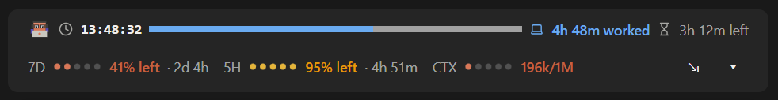

# claude-clock-bar

A Claude Code mod that puts a clock and a work-hour timer in a slim band right above the prompt bar.


## Best with claude-usage-bar

This mod works best combined with **[claude-usage-bar](https://github.com/ryanary/claude-usage-bar)**, which shows your usage limits and context. Install both and they share the space above the prompt: the clock row on top and the usage row right under it, so they read as one band.



## What it shows

| When | The band says |
|---|---|
| **Before work** | Starts in 25m · Work hours 08:00 – 17:00 |
| **Working** | 3h 18m worked · 4h 42m left, with a bar that fills through the day |
| **On break** | On break · 30m left · back 13:00 (the break doesn't count as worked) |
| **Done** | Work is done · 8h 00m today, plus a toast once a day |
| **Weekend** | Day off · Back Monday 08:00 |

Type `/clock` to expand the band to a big clock and the date, with a button that switches between the work timer and the clock alone. Type it again to collapse it.

## Settings

Set these when you install, or later in the plugin's settings.

| Setting | Default | What it does |
|---|---|---|
| **Work starts** | 08:00 | 24-hour time |
| **Work ends** | 17:00 | 24-hour time |
| **Break starts** | 12:00 | Leave blank for no break |
| **Break ends** | 13:00 | Leave blank for no break |
| **Skip weekends** | on | No work timer on Saturday and Sunday |

## Details

- **Desktop and terminal.** The desktop app draws icons, a tiny pixel crab and a filled bar. The terminal shows the same facts as text.
- **Same-day hours only.** Work must start and end on the same day, so night shifts aren't supported.
- **No extra cost.** It reads only your computer's clock. It makes no API calls.

## Install

In a terminal, add this repository as a plugin marketplace, then install the plugin from it:

```bash
claude plugin marketplace add ryanary/claude-clock-bar
```

```bash
claude plugin install work-clock@claude-clock-bar
```

In the desktop app: click **+** next to the prompt box, then **Plugins**, **Add marketplace** with `ryanary/claude-clock-bar`, then **Add plugin**.

Start a new Claude Code session, and the band appears above the prompt bar.

### Update

```bash
claude plugin marketplace update claude-clock-bar
```

```bash
claude plugin update work-clock@claude-clock-bar
```

### Uninstall

```bash
claude plugin uninstall work-clock@claude-clock-bar
```

## Development

The mod is [`hooks/register.tsx`](hooks/register.tsx), with its drawings in [`hooks/scene.ts`](hooks/scene.ts) and its tests in [`hooks/register.test.tsx`](hooks/register.test.tsx).

```bash
claude plugin validate .
```

```bash
claude plugin test .
```
